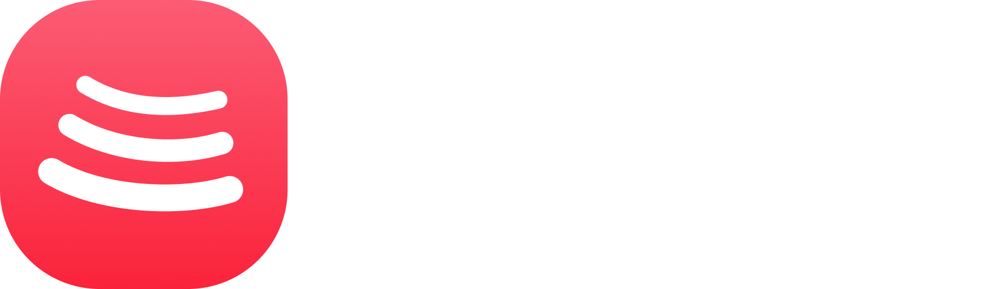

  
  <h1>Void Music</h1>
  
<strong>Your music. Your flow.</strong>

  
A customizable Android music client built around flexible sources, detailed playback controls, synced lyrics and an artwork-driven interface.

  

    
  

  

    
    
    
  

  
<a href="#features">Features</a> · <a href="#download">Download</a> · <a href="#build-from-source">Build from source</a> · <a href="#support-and-contributing">Support & contribute</a> · <a href="#legal-notice">Legal notice</a>

---

  

## About Void Music

Void Music is an Android music client focused on giving listeners more control over discovery, sources, playback and their personal library. Search and play music through supported online sources, bring in local or network music, customize playback behaviour, and keep useful track information close at hand.

The app supports configurable add-on/module sources, but each source is an independent dependency: availability, sign-in requirements, stream formats and download permissions depend on that source and its service.

## Features

### 🎧 Playback & audio controls

- **Online discovery:** search, browse and play available music through the YouTube Music integration.
- **Playback in the background:** persistent media controls and a playback notification.
- **Gapless playback and crossfade:** adjustable transitions, including a 0–12 second crossfade range.
- **Automix (Beta):** beat-aware queue transitions with tempo adjustment where analysis and track data allow.
- **Flexible controls:** playback speed from 0.5× to 2×, skip silence, sleep timer and system equalizer integration.
- **Per-network quality settings:** set separate streaming quality limits for Wi-Fi and mobile data.
- **Stats for Nerds:** inspect selected input details such as codec, sample rate and bit depth from the player.
- **Automatic best-source selection:** compare available source metadata when selecting a supported alternative rendition.

> **Audio-quality note:** Void Music does not promise that every track will be lossless, Hi-Res or Dolby Atmos. Those formats depend on what a configured source actually supplies, any required authorization, the device's decoder and the selected audio-output route. A source label or bitrate value alone is not proof of bit-perfect output.

### 🔌 Sources & integrations

- Add, edit, test and health-check supported add-on/module sources.
- Use supported alternate renditions when a configured source can resolve and deliver them.
- Connect supported Google/YouTube Music and Spotify account features.
- Scrobble listening activity to Last.fm and ListenBrainz when configured.
- Show current-track details through Discord Rich Presence when connected.
- Use Listen Together, supported casting options and network libraries where configured.

External services may change their APIs, authentication requirements or terms. A source appearing in the app does not guarantee that its service is currently available or authorized for every track.

### 📚 Library, downloads & cache

- Play local music alongside supported online sources.
- Save supported tracks for offline listening with available metadata and tags.
- Browse cached audio and manage the app's audio-cache storage limit.
- **Standard add-on cache:** prepare 1 upcoming add-on track.
- **Aggressive add-on cache:** prepare up to 5 upcoming add-on tracks, where the source and available resources permit it.
- Work with supported SMB/WebDAV network locations and personal libraries.

Download availability and format depend on the selected source and its permissions. Do not assume that a streaming source allows a track to be saved.

### ✨ Lyrics & interface

- Word-synced lyrics with highlighting when timed lyrics are available.
- Multiple lyrics providers, with availability varying by track and provider.
- Artwork-driven colours and animated artwork on the player where supported.
- Frosted-glass surfaces and a Material 3 interface.
- Playback queue, track actions, playlists and personal listening features.

## Download

  
  
<a href="https://github.com/OPZENITSUUU/VoidMusic/releases">View all releases and version notes</a>

**Platform:** Android 8.0 (API 26) or newer. An internet connection is required for online music and third-party services; local playback depends on the files or network locations you select.

### Install

1. Open the [latest release](https://github.com/OPZENITSUUU/VoidMusic/releases/latest) and download **\`Void.Music.apk\`**.
2. Open the downloaded APK and allow your file manager or browser to install apps from that source if Android asks.
3. Finish installation, open Void Music and configure any optional accounts or sources you use.

Android only permits an in-place app update when the installed and downloaded APKs use a compatible package identity and signing certificate. Back up important app data before changing builds or uninstalling an existing version.

## Build from source

### Requirements

- A compatible JDK (17 or newer)
- Android SDK with the platform/build tools required by the Gradle project
- Android NDK/CMake components requested by the project for native audio components

### Build a development APK

\`\`\`bash
git clone https://github.com/OPZENITSUUU/VoidMusic.git
cd VoidMusic
./gradlew :app:assemblePersonalDebug
\`\`\`

The development APK is produced under \`app/build/outputs/apk/personal/debug/\`. To run the corresponding unit tests:

\`\`\`bash
./gradlew :app:testPersonalDebugUnitTest :sharedUi:jvmTest
\`\`\`

A distributable release must be built and signed with an authorized release key. Signing keys and passwords are intentionally not included in the repository; never commit keystores, signing properties or service secrets.

## Project layout

| Path | Purpose |
| --- | --- |
| \`app/\` | Android application, playback, sources, lyrics, downloads and UI |
| \`shared/\` | Shared models and supporting functionality |
| \`sharedUi/\` | Shared player and interface components |
| \`wearos/\` | Companion/watch integration and shared protocol |
| \`desktopApp/\`, \`desktopUi/\` | Desktop-related project work; see [\`DESKTOP.md\`](DESKTOP.md) for current notes |
| \`docs/\` | Project documentation and implementation notes |

## Support and contributing

Bug reports and feature requests belong in [GitHub Issues](https://github.com/OPZENITSUUU/VoidMusic/issues). Before opening a pull request, please read the project guides:

- [Contributing guide](CONTRIBUTING.md)
- [Code of conduct](CODE_OF_CONDUCT.md)
- [Maintainers](MAINTAINERS.md)
- [Additional documentation and credits](ADDITIONAL.md)
- [Desktop notes](DESKTOP.md)

When reporting playback problems, include the app version, Android version, selected source, and relevant **Stats for Nerds** details. Remove account tokens, private source URLs and other secrets from logs before sharing them.

## Legal notice

Void Music is an independent community distribution and is **not affiliated with or endorsed by Google, YouTube, YouTube Music, Spotify, Discord, TIDAL, Qobuz or their parent companies**. Service names and trademarks belong to their respective owners.

Void Music does not host third-party music catalogues. It acts as a client for supported services, configurable sources and user-provided local/network media. You are responsible for having the rights and authorization required for the content you access or save, and for following applicable law and the terms of any third-party service. Features and source compatibility can change without notice when external services change.

### Upstream attribution

This repository builds on the open-source [BitChord](https://github.com/kushagrasinghx/BitChord) project. Upstream licensing, copyright notices and attribution requirements are retained. Void Music's branding and release assets are maintained for this distribution; this does not imply endorsement by the upstream project or any third-party service.

## License

This project is distributed under the **GNU General Public License v3.0 (GPL-3.0)**. Read the [\`LICENSE\`](LICENSE) file for the full terms. Redistributions must follow the license's source-availability and notice requirements.

---

  Made for listening, tinkering and making the music experience your own. 🎵

